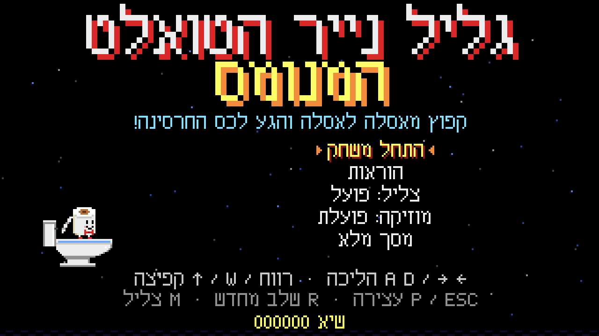
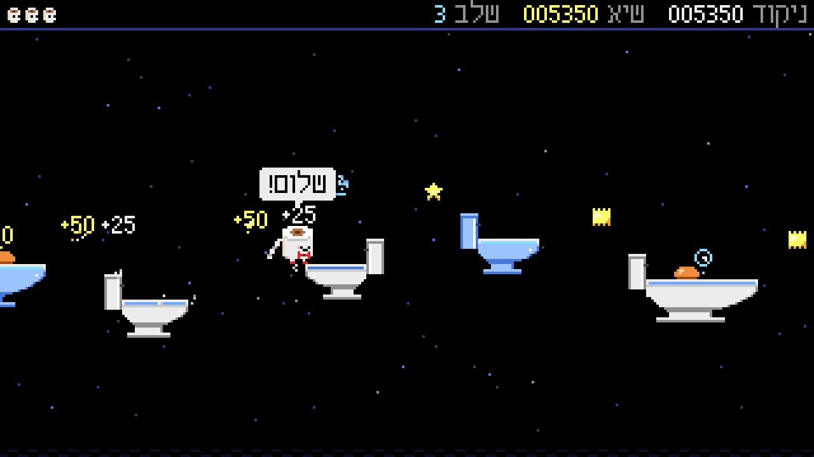
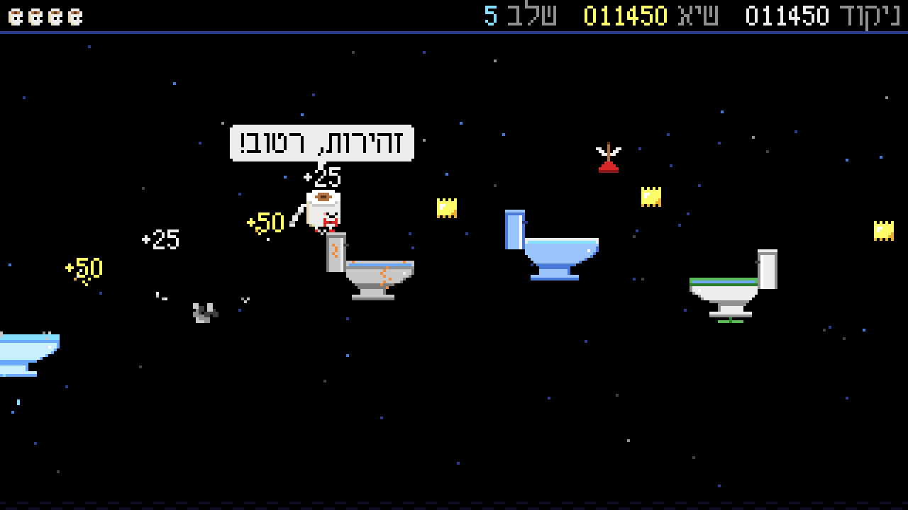
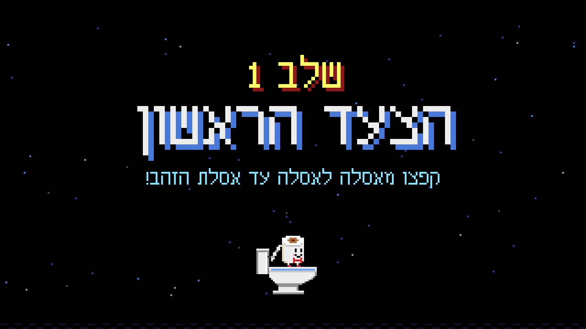
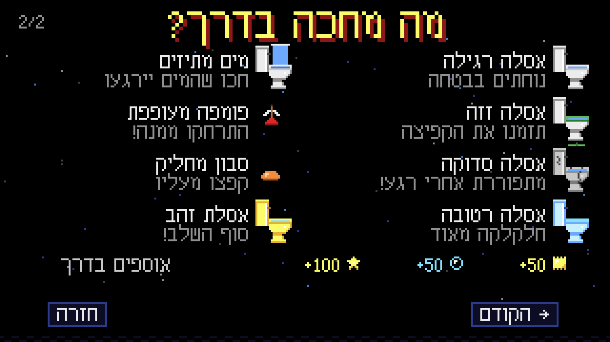
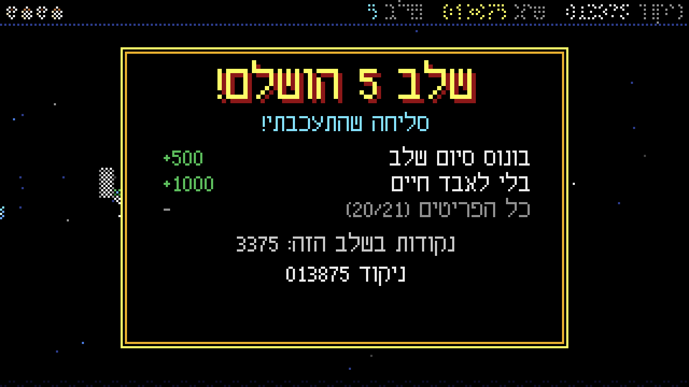
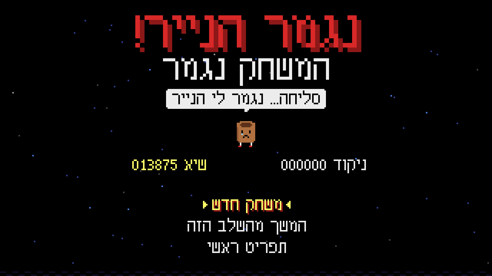
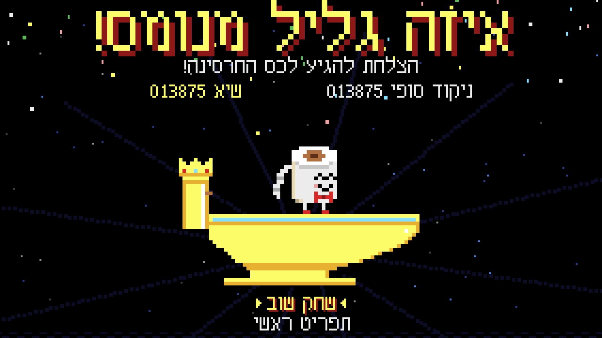
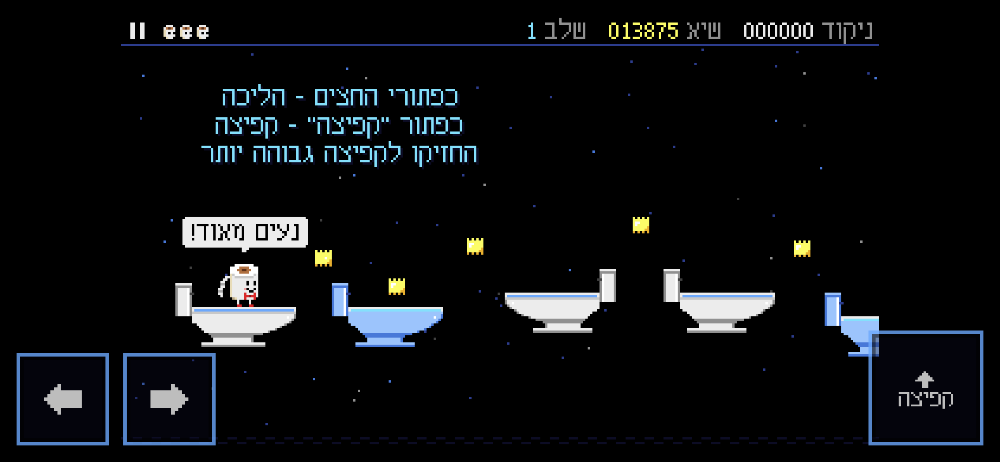

# גליל נייר הטואלט המנומס
### The Polite Toilet Paper Roll

משחק פלטפורמה דו־ממדי : גליל נייר טואלט מנומס במיוחד קופץ מאסלה לאסלה מעל החושך, בדרך אל כס החרסינה.

A 2D platformer game: an extremely polite toilet paper roll jumps from toilet to toilet over the darkness, on its way to the legendary Porcelain Throne.



## צילומי מסך / Screenshots

| | |
|---|---|
|  |  |
| שלב 3: התזות מים, סבון ובועות | שלב 5: אסלות סדוקות, זזות ופומפה מעופפת |
|  |  |
| פתיחת שלב | מה מחכה בדרך |
|  |  |
| סיכום שלב | נגמר הנייר! |
|  |  |
| כס החרסינה: ניצחון | בטלפון: כפתורי מגע |

---

## איך מפעילים / How to run

**פשוט לפתוח את `index.html` בדפדפן** (לחיצה כפולה). אין התקנה, אין שרת, אין חיבור לאינטרנט.

Just open **`index.html`** in a browser (double‑click). No install, no server, no internet connection needed.

Optional local server (e.g. for testing on a phone on the same Wi‑Fi):

```
python -m http.server 8000
```
then browse to `http://localhost:8000` (or `http://<your-PC-IP>:8000` from the phone).

## שליטה / Controls

| פעולה | מקלדת | מסך מגע |
|---|---|---|
| הליכה | ← → / A D | כפתורי החצים |
| קפיצה (לחיצה ארוכה = גבוה יותר) | רווח / W / ↑ | כפתור "קפיצה" |
| התחלה / אישור | Enter | הקשה על התפריט |
| עצירה / המשך | P / Esc | כפתור II למעלה |
| התחלת השלב מחדש | R | מתפריט העצירה |
| השתקת צליל | M | מתפריט העצירה |
| מסך מלא | F | מהתפריט הראשי |

The keys work with any keyboard layout (including Hebrew), because the game reads physical key positions.

## המשחק / The game

- **5 שלבים**: הצעד הראשון · בין האסלות · זהירות, רטוב! · אסלות בתנועה · כס החרסינה.
- **אסלות**: רגילה, כחולה, זזה (מושב ירוק + מדחף), סדוקה (מתפוררת אחרי רגע), רטובה (חלקלקה), ואסלת זהב בסוף כל שלב. גם מכסה המיכל הוא משטח נחיתה.
- **מכשולים**: פומפות מעופפות, סבון מחליק, התזות מים מהאסלה (עם בועות ו־"!" לפני ההתזה), והחושך שבין האסלות.
- **ניקוד**: דף זהב / בועת סבון +50, כוכב +100, נחיתה ראשונה על אסלה +25, נחיתה מנומסת (במרכז המושב) +100, סיום שלב +500, בלי לאבד חיים +1000, כל הפריטים +300. חיים נוספים ב־10,000 נקודות.
- **3 חיים**. נפילה או פגיעה = חיים אחד, וחזרה לתחילת השלב (פריטים שנאספו נשארים אצלכם).
- **השיא נשמר** בדפדפן (localStorage) גם אחרי רענון.

## Project structure

```
index.html        page shell (lang="he", dir="rtl")
css/style.css     layout, scaling, touch buttons
js/config.js      resolution, palette, physics & scoring constants
js/font.js        hand-made Hebrew/Latin pixel font + bidi (RTL) text layout
js/sprites.js     all pixel art (roll, toilets, items, hazards), pre-rendered
js/levels.js      the five level layouts
js/sim.js         deterministic simulation: physics, platforms, hazards, collisions
js/audio.js       Web Audio synthesized sound effects + 3 music loops
js/input.js       keyboard + multi-touch input
js/score.js       score, lives, high score persistence
js/renderer.js    world drawing (320x180 canvas, nearest-neighbour scaling)
js/ui.js          Hebrew menus, HUD and all screens
js/game.js        state machine, fixed 60 Hz loop, effects, personality
js/main.js        boot: layout, touch controls, auto-pause, accessibility
tools/            optional developer tools (not needed to play)
```

Plain HTML5 + Canvas + JavaScript (classic scripts, so it also runs from `file://`). No frameworks, no build step, no dependencies.

## Developer tools (optional)

**Level verifier** (Node.js only, no packages). It runs the game's real physics with a search bot and proves every level can be completed. It also reports how many frames of jump timing each required jump allows:

```
node tools/verify-levels.js                 # all levels
node tools/verify-levels.js 3 --forgiveness # level 3 + jump timing windows
node tools/verify-levels.js --save          # also write tools/solutions.json
```

**Browser test**: drives the real game in headless Chrome/Edge. It covers menus, keyboard, touch, all 5 levels, death, game over, victory, pause, mute, high score after reload, and screen sizes:

```
npm install --no-save puppeteer-core
node tools/verify-levels.js --save
node tools/browser-test.js --shots          # screenshots go to tools/screenshots/
```
